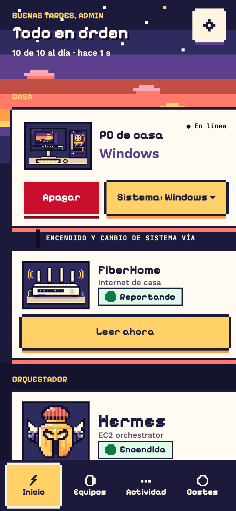
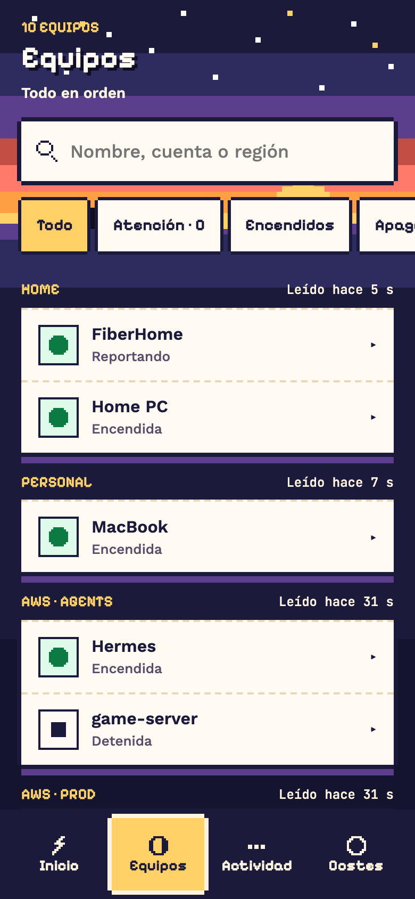
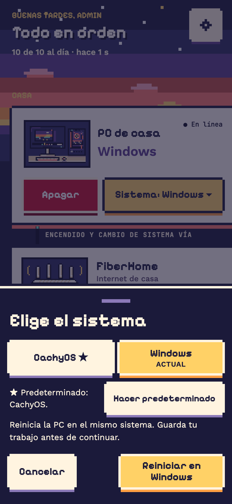
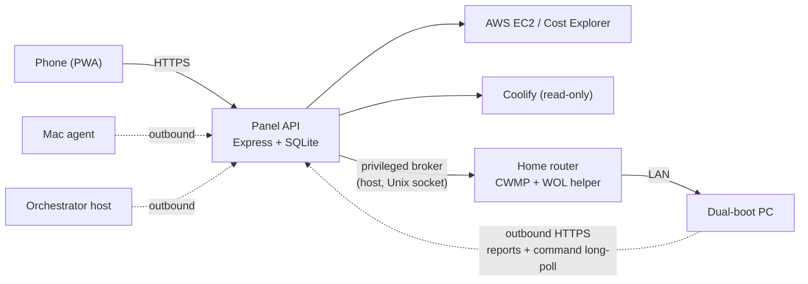

# Infra Control

A private, phone-first control panel for my own infrastructure: cloud instances, a dual-boot PC, a home router, a Mac and an AI orchestrator, with a pixel-art UI and an obsessive rule: **never claim something the system did not verify.**

<p align="center">
  
  
  
</p>

> **Status: personal project, opinionated.** It runs my setup in production. Some pieces assume my hardware (a FiberHome router managed over CWMP, a Windows/CachyOS dual-boot PC woken through that router). Devices are not pluggable yet, it is single-user (`admin`) and the UI text is in Spanish. It is published as a portfolio piece and a reference for the ideas below, not as a polished product.

## What it does

- **Cloud:** start/stop EC2 instances across several AWS accounts (IAM users scoped to an explicit allowlist), read-only Coolify services, cost and budget reports with a 24 h cache.
- **PC (Windows + Linux dual boot):** wake-on-LAN through the router, power off, reboot into either system, reboot into the *same* system, and read/change the firmware's default boot entry, all with the same confirmation flow.
- **Presence and health:** outbound reporters for the PC (both systems), a Mac, the router and the orchestrator host; staleness is shown as such, never as "off".
- **Web Push** for the things that matter, and a PWA you can install on a phone.

## Ideas worth stealing

1. **Honest state.** An operation is `accepted`, `running`, `succeeded`, `failed` or `uncertain`. HTTP 202 only means "accepted". If a write might have reached the provider, the panel never retries it: it stays `uncertain` until the real state resolves it. Silence from a PC is "no signal", not "powered off". Every reading carries its own `observedAt`.
2. **Closed commands, outbound agents.** Agents never listen on a port and never accept a shell, a destination or free arguments. A PC agent keeps an outbound HTTPS long-poll and runs only `off`, `windows`, `cachyos` (or a `ping`), after checking the order belongs to its current boot (`bootId`). SSH through a privileged broker remains as a fallback, and an order already delivered is never re-sent by another path (single execution).
3. **Measured, not guessed.** Delivering an order to the PC went from about 4 s over SSH to about 0.4 s round trip with the direct channel. A reboot from Windows to Linux went from 69 s to 50 s end to end; the remaining time is the PC itself (shutdown, firmware, boot).
4. **A deployment gate.** Deploys are refused while any operation is active, and a consistent SQLite backup is taken first, so a redeploy can never interrupt a power command halfway.

## Architecture



- `server/` – TypeScript API (Express 5, SQLite, one process on purpose: quotas and recovery rely on it).
- `design/handoff/` – React 19 + TypeScript UI (Vite), the design tokens, hand-drawn SVG pixel sprites, unit and Playwright/axe E2E tests.
- `ops/` – agents and helpers: PC (Windows/Linux), Mac, router, orchestrator, and the deployment gate for the VPS.
- `contracts/` – the public API contract (`openapi.json` is generated and checked).

## Quick start (UI with simulated data)

```bash
cd design/handoff
npm ci
npm run dev        # fixture mode: simulated devices, no real actions
```

## Run the API

Requirements: Node 24.

```bash
npm ci
npm run build && npm test

# 1. Create credentials (secrets are never passed as arguments)
echo 'a long password' | npx tsx scripts/make-credentials.ts reader windows cachyos

# 2. Copy config.example.json to a private location, fill it in and point CONFIG_PATH at it
CONFIG_PATH=/path/to/config.json DATA_DIR=./data npm start
```

`config.example.json` lists every key; most sections are optional and the panel only shows what you configure.
Keep the real configuration outside the repository and mounted read-only. The PC-control broker and the agent
installers live in `ops/` (see the READMEs there, written in Spanish). Placeholders such as the PC's MAC address and
SSH users must be replaced with yours (`PC_SSH_USER_WINDOWS`, `PC_SSH_USER_LINUX`, `PC_MAC`).

## Tests

| Suite | Command |
|---|---|
| API | `npm test` |
| UI unit + types + contract | `cd design/handoff && npm test && npm run typecheck && npm run contract` |
| UI E2E (Playwright + axe) | `cd design/handoff && npm run test:e2e` |
| Agents and gate | `python3 -m unittest discover -s ops/pc/reporters -p 'test_*.py'` |

Power paths were also exercised on real hardware: reboots between both systems, shutdowns and wake-on-LAN.

## Built with AI agents

This project was built end to end with AI coding agents (Claude Code and Codex) under my direction. I decided what
it should do and how it should behave, reviewed the results and verified them on real machines. The measurements above
come from that setup. The design documents in `design/` are mostly in Spanish.

## Roadmap

- Devices as configuration (several PCs, any number of systems) instead of fixed ids.
- A provider interface so the router and cloud pieces are replaceable.
- Passkeys instead of a password, and a tailnet-only mode.
- English UI strings.

## License

Apache License 2.0, see [LICENSE](LICENSE) and [NOTICE](NOTICE). Bundled fonts are under the SIL Open Font License
(see [THIRD_PARTY_NOTICES.md](THIRD_PARTY_NOTICES.md)). To report a vulnerability see [SECURITY.md](SECURITY.md).
